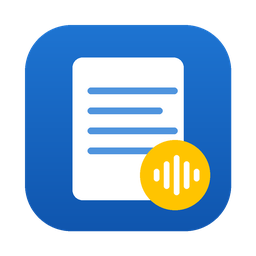
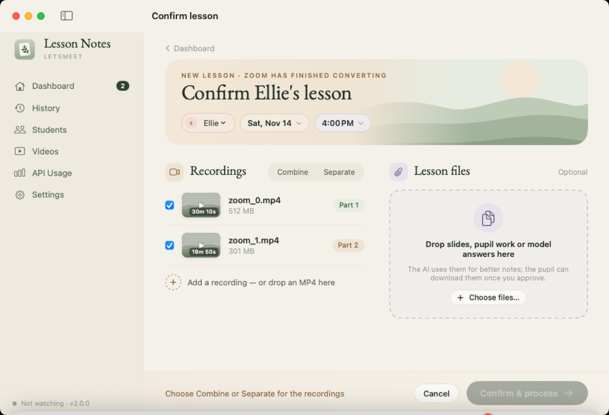
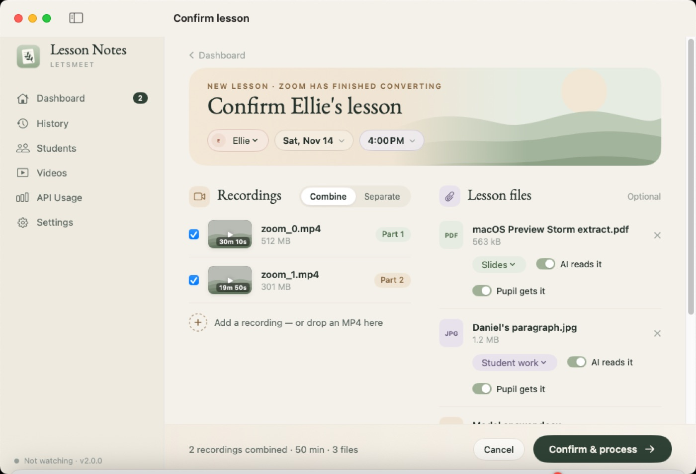
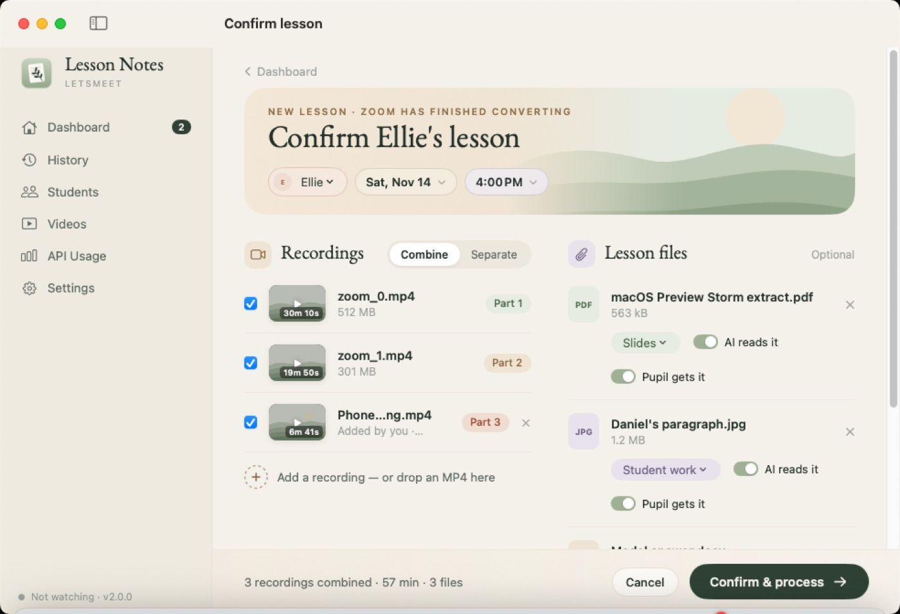
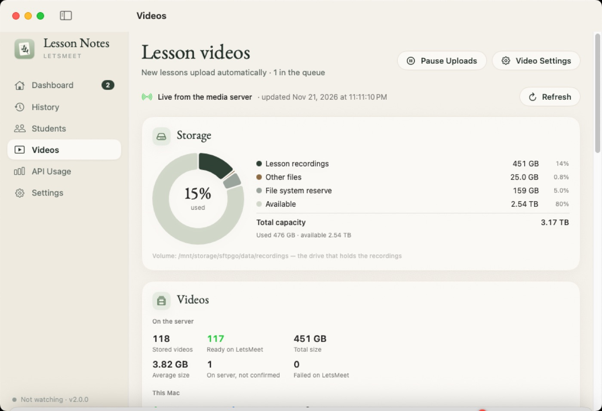
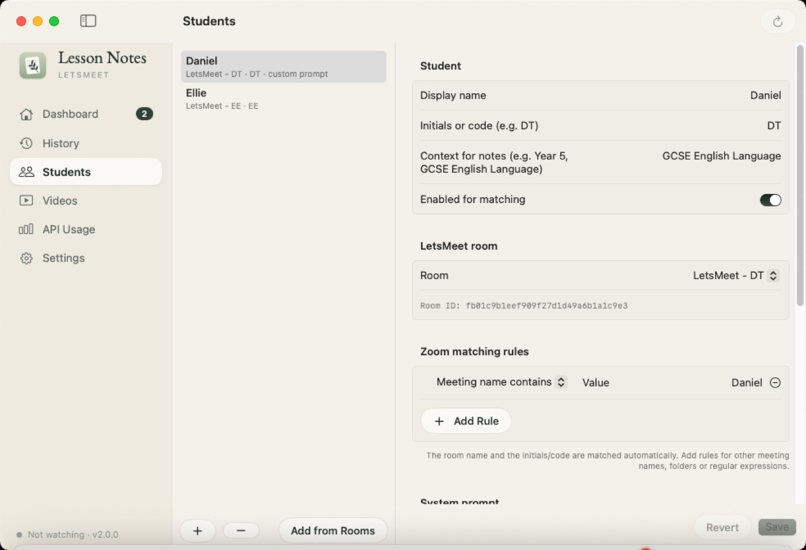
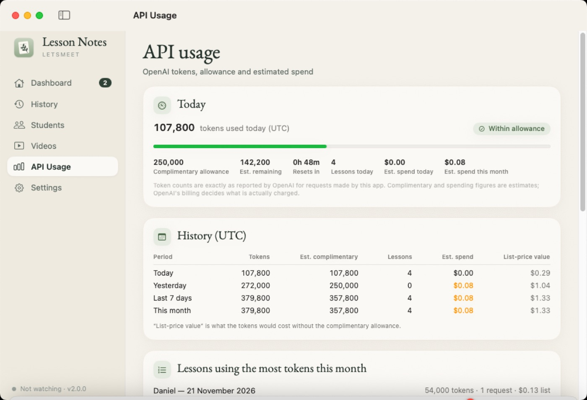
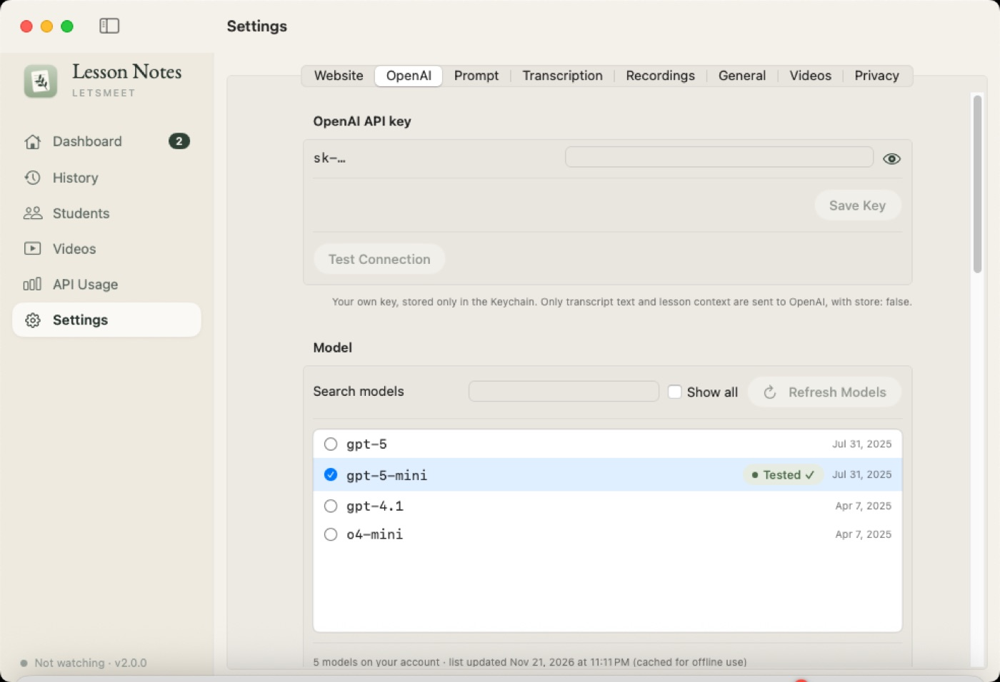

<div align="center">



# LetsMeet Lesson Notes

**Turns Zoom lesson recordings into polished, accurate lesson notes — transcribed privately on your Mac.**

A native macOS menu-bar app for George Hall Tuition. It finds new Zoom recordings, transcribes them on-device,
writes structured revision notes with OpenAI and sends them to LetsMeet, where they wait for approval.

[](../../releases)
&nbsp;


<br>


<sub>New in 2.0: a calmer, botanical look · <a href="CHANGELOG.md">version history</a> · <a href="docs/versions/v1.10/README.md">how 1.10 looked</a></sub>

</div>

---

## Contents

- [How it works](#how-it-works)
- [Confirming a lesson](#confirming-a-lesson)
- [Features](#features)
- [Screenshots](#screenshots)
- [Install](#install)
- [Privacy & safeguarding](#privacy--safeguarding)
- [Version history](#version-history)
- [For developers](#for-developers)

## How it works


Once you press **Confirm**, everything else is automatic — extraction, transcription, notes, upload and status tracking.
Transcription happens on the Mac; lesson videos go only to your own media server, attached to the approved note.

## Confirming a lesson

When Zoom finishes converting, a notification offers **Review**. The Confirm screen opens full-window:

<table>
<tr>
<td width="50%"><br><sub><b>1 · Check who and when</b> — pupil, date and time sit under the title; the recordings are listed in order. Drop lesson files on the right.</sub></td>
<td width="50%"><br><sub><b>2 · Add lesson files</b> — for each file, say what it is (colour-coded), and whether the AI reads it and the pupil gets it.</sub></td>
</tr>
<tr>
<td><br><sub><b>3 · Add another recording</b> — drop an MP4 (or M4A) onto the recordings, or choose one. It joins as the next part; drag to reorder, and pick Combine or Separate.</sub></td>
<td valign="middle"><b>4 · Confirm & process</b><br><br>The line at the bottom sums it up (or says what is still needed). Press <b>Confirm & process</b> and the lesson slides onto the Dashboard: transcribed on the Mac, notes written, sent to LetsMeet to wait for your approval. A notification tells you when it's there.</td>
</tr>
</table>

## Features

<table>
<tr>
<td width="50%" valign="top">

### 🎬 Finds your lessons
- Watches your Zoom folder and waits until Zoom has **finished converting**
- Suggests the pupil from the meeting name, initials (`LetsMeet - DT` → Daniel), folder or your own rules
- Native notification with **Review** — one click to confirm
- **Historical import** of single files or whole folders, grouped into lessons with dates worked out from Zoom folder names

</td>
<td width="50%" valign="top">

### 🎙️ Private transcription
- **WhisperKit** on Apple Silicon (Core ML) — no audio is uploaded
- Download, switch and delete models in-app, with storage shown
- Timestamps and recording boundaries kept
- Single, **combined** or **separate** processing for multi-part lessons

</td>
</tr>
<tr>
<td valign="top">

### ✍️ Proper revision notes
- Title, overview, **learning content**, **worked examples**, **key quotes**, key points, vocabulary, next steps, homework, praise and private tutor notes
- Markdown headings, lists, tables and bold, previewed exactly as pupils see them
- Strict empty-field rules: nothing invented, no "None" filler
- Global prompt plus optional **per-pupil prompts**
- **Lesson files** (slides, pupil work, your exemplars) used as AI context and shared with the pupil

</td>
<td valign="top">

### 🔁 Review, regenerate, replace
- **Regenerate Notes** from the saved transcript — choose a prompt, model and extra instructions
- **Side-by-side comparison** with changed sections highlighted
- **Replace Existing Notes** on LetsMeet (no duplicates), safe retries and version-conflict handling
- Local version history

</td>
</tr>
<tr>
<td valign="top">

### 🤖 Your OpenAI account
- Live model list from your account, searchable and cached
- **Test Model** with harmless sample data before you rely on it
- Reasoning effort and output-length controls
- Only complete, validated responses are accepted — no truncated notes

</td>
<td valign="top">

### 🛡️ Built to be reliable
- Persistent queue that survives restarts, sleep and going offline
- Automatic retries with back-off; safe, idempotent uploads
- Duplicate-recording warnings using SHA-256
- Full transcript always uploaded, with UTF-8 size limits enforced
- **OpenAI usage counter** with optional free-allowance protection
- Lesson length sent to LetsMeet (admin-only)

</td>
</tr>
</table>

## Screenshots

<table>
<tr>
<td width="50%"><br><sub><b>History</b> — every lesson with its website status; search by pupil, date, title or transcript</sub></td>
<td width="50%"><br><sub><b>Lesson videos</b> — media-server storage, video counts, bandwidth and uploads</sub></td>
</tr>
<tr>
<td><br><sub><b>Students</b> — room mapping, matching rules and per-pupil prompts</sub></td>
<td><br><sub><b>API usage</b> — today's tokens against the free allowance, estimated spend</sub></td>
</tr>
<tr>
<td><br><sub><b>Settings</b> — OpenAI model list, Test Model, transcription and videos</sub></td>
<td><br><sub><b>Dark mode</b> — follows your Mac's appearance</sub></td>
</tr>
</table>

<sub>Screenshots use built-in sample data; names and notes are illustrative.</sub>

## Install

1. Download the latest **`.dmg`** from [**Releases**](../../releases).
2. Open it and drag **LetsMeet Lesson Notes** onto **Applications**.
3. **First launch:** the app is not notarised yet, so macOS blocks it once. Open
   **System Settings → Privacy & Security** and click **Open Anyway**.
4. Follow the **Setup Assistant**: website key, rooms, OpenAI key and model, Zoom folder, transcription model, students and prompt.

> [!TIP]
> **Updating?** Quit the app, drag the new version over the old one and choose **Replace**. Settings, API keys, students,
> prompts, transcripts and history are all kept. If macOS asks about keychain access, choose **Always Allow**.

## Privacy & safeguarding

| Data | Where it goes |
| --- | --- |
| 🎙️ Audio for transcription | **Stays on your Mac.** Extracted to a temporary file and deleted after each lesson. Never sent to OpenAI. |
| 🎥 Lesson videos | Uploaded (when video uploads are on) to your own media server through LetsMeet's signed, expiring links, attached to the note. Pupils can watch only approved notes. Originals are never changed or deleted. |
| 📝 Transcript text | OpenAI (to write the notes, `store: false`) and LetsMeet (stored for you in Admin Tools; never shown to pupils). |
| 📎 Lesson files | Copied into the app when you add them. Uploaded to LetsMeet with the note (pupils can download them after you approve). Files you mark **Include in AI context** are also sent to OpenAI with the transcript (`store: false`). Audio and video are never accepted. |
| 📚 Lesson notes | LetsMeet — pupils only see notes **after you approve them**. Private tutor notes are never shown to pupils. |
| 🔑 API keys | macOS Keychain only. |
| 📊 Analytics | None. Transcripts, notes and keys are never logged. |

Local transcripts follow your retention setting (forever, 1 year, 90 or 30 days) and can be deleted from History at any time.

## Version history

Every version is listed in **[CHANGELOG.md](CHANGELOG.md)** with a DMG download, so an older version can always be
reinstalled (your data is kept). The 1.x look is archived in [docs/versions/v1.10](docs/versions/v1.10/README.md).

## For developers

<details>
<summary><b>Project layout, building and tests</b></summary>

```
Packages/LessonNotesCore   Platform-independent logic + unit tests
                           (API clients, processing queue, import & grouping,
                            prompts, notes schema, regeneration, Markdown)
App/Sources                macOS app — SwiftUI, AVFoundation, WhisperKit, Keychain, FSEvents
project.yml                XcodeGen project definition
.github/workflows          build-macos.yml  tests → build → launch check → DMG → release
                           screenshots.yml  README screenshots from sample data
docs/                      testing record, release-notes template, images
```

| | |
| --- | --- |
| Run core tests | `cd Packages/LessonNotesCore && swift test` |
| Open in Xcode | `brew install xcodegen && xcodegen generate && open LessonNotes.xcodeproj` |
| Website limits | `Packages/LessonNotesCore/Sources/LessonNotesCore/API/APILimits.swift` |
| Default prompt | `Packages/LessonNotesCore/Sources/LessonNotesCore/Prompts/PromptLibrary.swift` |

Every push builds a DMG on GitHub's macOS runner and publishes it as a pre-release.
See [docs/TESTING.md](docs/TESTING.md) for what is covered by automated tests and what to check with real recordings.

</details>

---

<div align="center">
<sub>Made for George Hall Tuition · native Swift & SwiftUI · Apple Silicon</sub>
</div>
