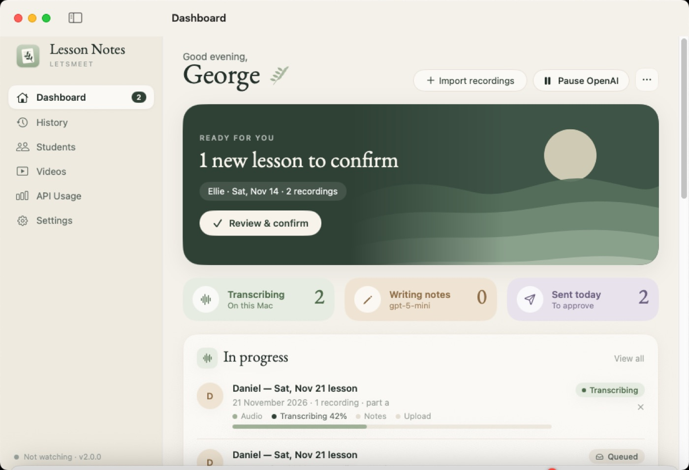
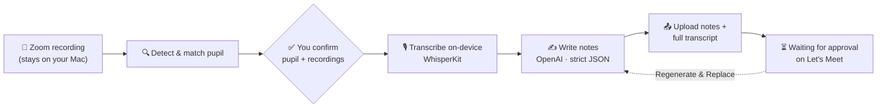
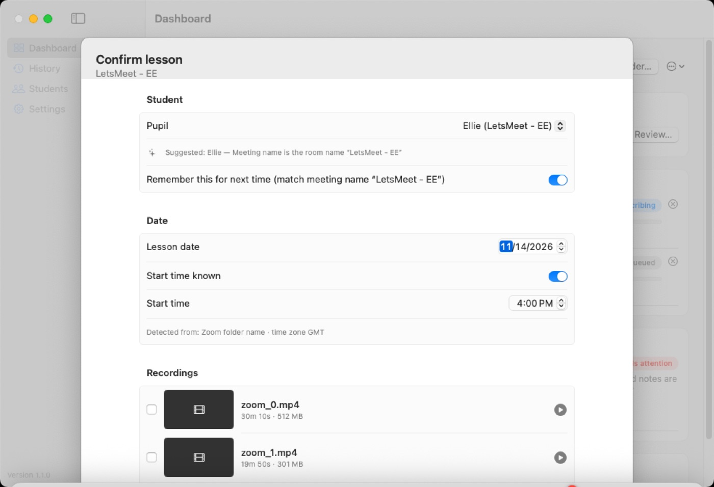
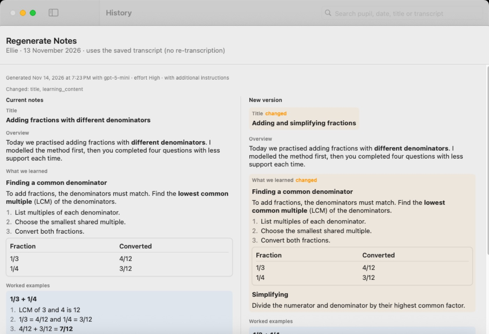
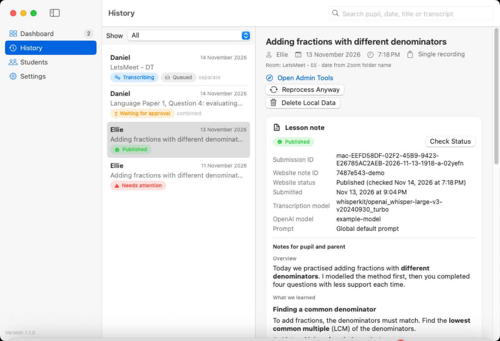
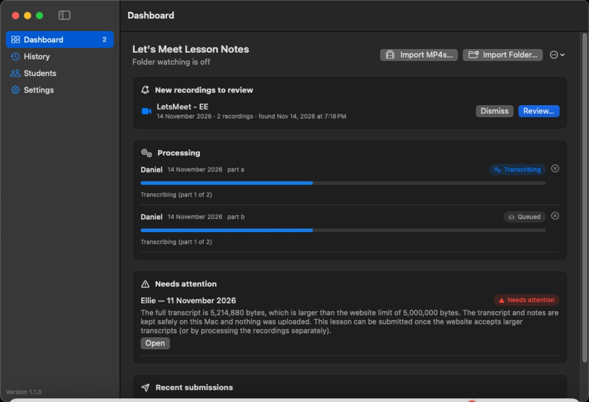

<div align="center">


# Let's Meet Lesson Notes

**Turns Zoom lesson recordings into polished, accurate lesson notes — transcribed privately on your Mac.**

A native macOS menu-bar app for George Hall Tuition. It finds new Zoom recordings, transcribes them on-device,
writes structured revision notes with OpenAI and sends them to Let's Meet, where they wait for approval.

[](../../releases)
&nbsp;


<br>



</div>

---

## Contents

- [How it works](#how-it-works)
- [Features](#features)
- [Screenshots](#screenshots)
- [Install](#install)
- [Privacy & safeguarding](#privacy--safeguarding)
- [For developers](#for-developers)

## How it works



Once you press **Confirm**, everything else is automatic — extraction, transcription, notes, upload and status tracking.
Audio and video never leave the Mac.

## Features

<table>
<tr>
<td width="50%" valign="top">

### 🎬 Finds your lessons
- Watches your Zoom folder and waits until Zoom has **finished converting**
- Suggests the pupil from the meeting name, initials (`LetsMeet - DT` → Daniel), folder or your own rules
- Native notification with **Review** — one click to confirm
- **Historical import** of single files or whole folders, grouped into lessons with dates worked out from Zoom folder names

</td>
<td width="50%" valign="top">

### 🎙️ Private transcription
- **WhisperKit** on Apple Silicon (Core ML) — no audio is uploaded
- Download, switch and delete models in-app, with storage shown
- Timestamps and recording boundaries kept
- Single, **combined** or **separate** processing for multi-part lessons

</td>
</tr>
<tr>
<td valign="top">

### ✍️ Proper revision notes
- Title, overview, **learning content**, **worked examples**, **key quotes**, key points, vocabulary, next steps, homework, praise and private tutor notes
- Markdown headings, lists, tables and bold, previewed exactly as pupils see them
- Strict empty-field rules: nothing invented, no "None" filler
- Global prompt plus optional **per-pupil prompts**

</td>
<td valign="top">

### 🔁 Review, regenerate, replace
- **Regenerate Notes** from the saved transcript — choose a prompt, model and extra instructions
- **Side-by-side comparison** with changed sections highlighted
- **Replace Existing Notes** on Let's Meet (no duplicates), safe retries and version-conflict handling
- Local version history

</td>
</tr>
<tr>
<td valign="top">

### 🤖 Your OpenAI account
- Live model list from your account, searchable and cached
- **Test Model** with harmless sample data before you rely on it
- Reasoning effort and output-length controls
- Only complete, validated responses are accepted — no truncated notes

</td>
<td valign="top">

### 🛡️ Built to be reliable
- Persistent queue that survives restarts, sleep and going offline
- Automatic retries with back-off; safe, idempotent uploads
- Duplicate-recording warnings using SHA-256
- Full transcript always uploaded, with UTF-8 size limits enforced

</td>
</tr>
</table>

## Screenshots

<table>
<tr>
<td width="50%"><br><sub><b>Confirm a lesson</b> — suggested pupil, date, recordings with previews and processing mode</sub></td>
<td width="50%"><br><sub><b>Regenerate & compare</b> — new version side by side, changes highlighted</sub></td>
</tr>
<tr>
<td><br><sub><b>History</b> — searchable by pupil, date, title or transcript, with website status</sub></td>
<td><br><sub><b>Students</b> — room mapping, matching rules and per-pupil prompts</sub></td>
</tr>
<tr>
<td><br><sub><b>OpenAI</b> — live model list, Test Model and reasoning effort</sub></td>
<td><br><sub><b>Dark mode</b> — follows your Mac's appearance</sub></td>
</tr>
</table>

<sub>Screenshots use built-in sample data; names and notes are illustrative.</sub>

## Install

1. Download the latest **`.dmg`** from [**Releases**](../../releases).
2. Open it and drag **Let's Meet Lesson Notes** onto **Applications**.
3. **First launch:** the app is not notarised yet, so macOS blocks it once. Open
   **System Settings → Privacy & Security** and click **Open Anyway**.
4. Follow the **Setup Assistant**: website key, rooms, OpenAI key and model, Zoom folder, transcription model, students and prompt.

> [!TIP]
> **Updating?** Quit the app, drag the new version over the old one and choose **Replace**. Settings, API keys, students,
> prompts, transcripts and history are all kept. If macOS asks about keychain access, choose **Always Allow**.

## Privacy & safeguarding

| Data | Where it goes |
| --- | --- |
| 🎥 Recordings & audio | **Stay on your Mac.** Audio is extracted to a temporary file and deleted after each lesson; originals are never deleted. |
| 📝 Transcript text | OpenAI (to write the notes, `store: false`) and Let's Meet (stored for you in Admin Tools; never shown to pupils). |
| 📚 Lesson notes | Let's Meet — pupils only see notes **after you approve them**. Private tutor notes are never shown to pupils. |
| 🔑 API keys | macOS Keychain only. |
| 📊 Analytics | None. Transcripts, notes and keys are never logged. |

Local transcripts follow your retention setting (forever, 1 year, 90 or 30 days) and can be deleted from History at any time.

## For developers

<details>
<summary><b>Project layout, building and tests</b></summary>

```
Packages/LessonNotesCore   Platform-independent logic + unit tests
                           (API clients, processing queue, import & grouping,
                            prompts, notes schema, regeneration, Markdown)
App/Sources                macOS app — SwiftUI, AVFoundation, WhisperKit, Keychain, FSEvents
project.yml                XcodeGen project definition
.github/workflows          build-macos.yml  tests → build → launch check → DMG → release
                           screenshots.yml  README screenshots from sample data
docs/                      testing record, release-notes template, images
```

| | |
| --- | --- |
| Run core tests | `cd Packages/LessonNotesCore && swift test` |
| Open in Xcode | `brew install xcodegen && xcodegen generate && open LessonNotes.xcodeproj` |
| Website limits | `Packages/LessonNotesCore/Sources/LessonNotesCore/API/APILimits.swift` |
| Default prompt | `Packages/LessonNotesCore/Sources/LessonNotesCore/Prompts/PromptLibrary.swift` |

Every push builds a DMG on GitHub's macOS runner and publishes it as a pre-release.
See [docs/TESTING.md](docs/TESTING.md) for what is covered by automated tests and what to check with real recordings.

</details>

---

<div align="center">
<sub>Made for George Hall Tuition · native Swift & SwiftUI · Apple Silicon</sub>
</div>
